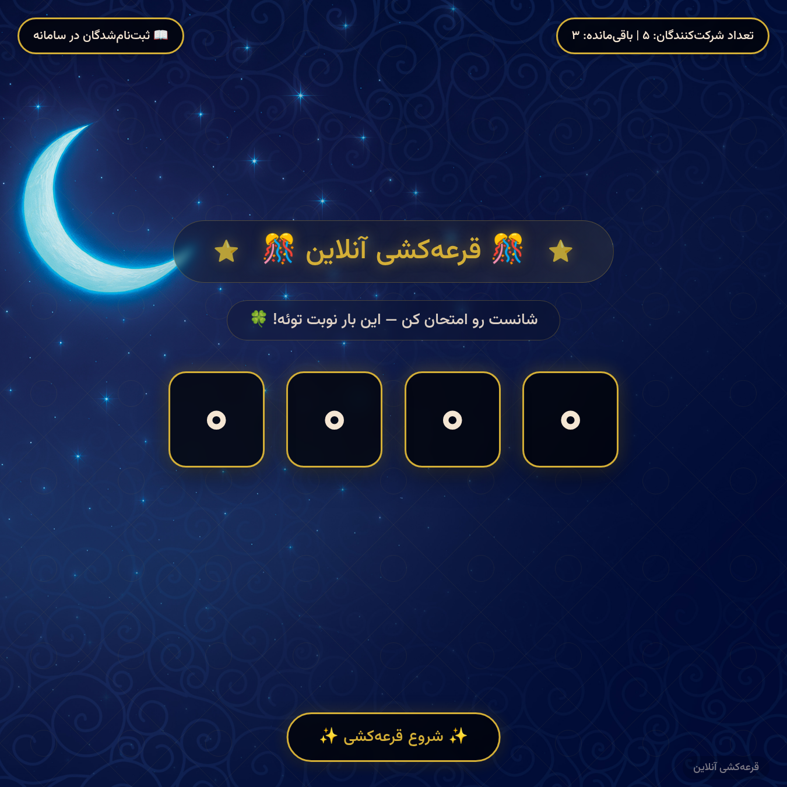
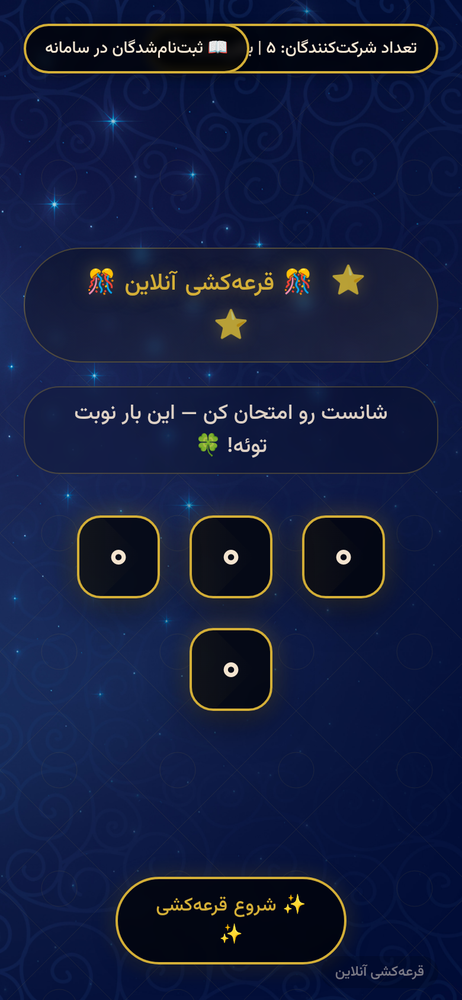
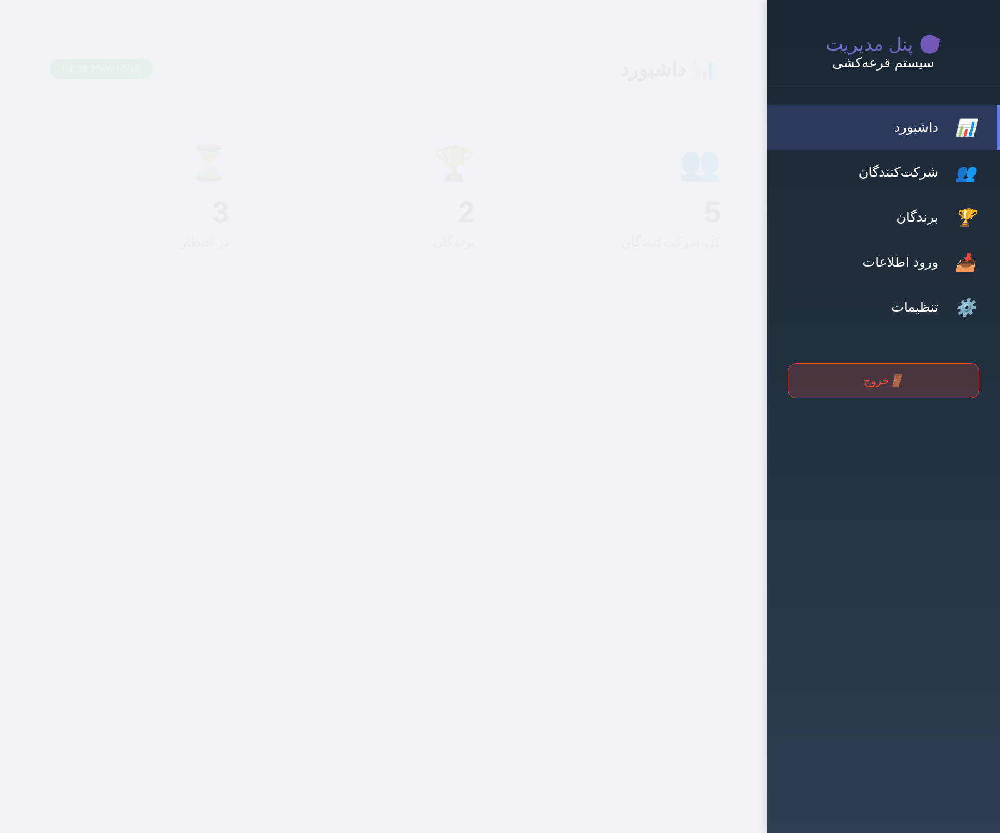
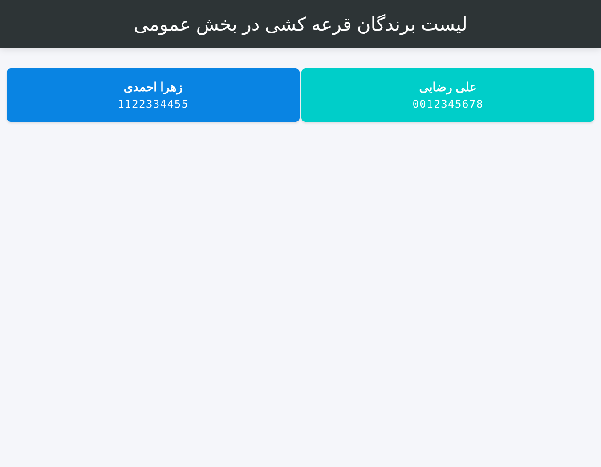
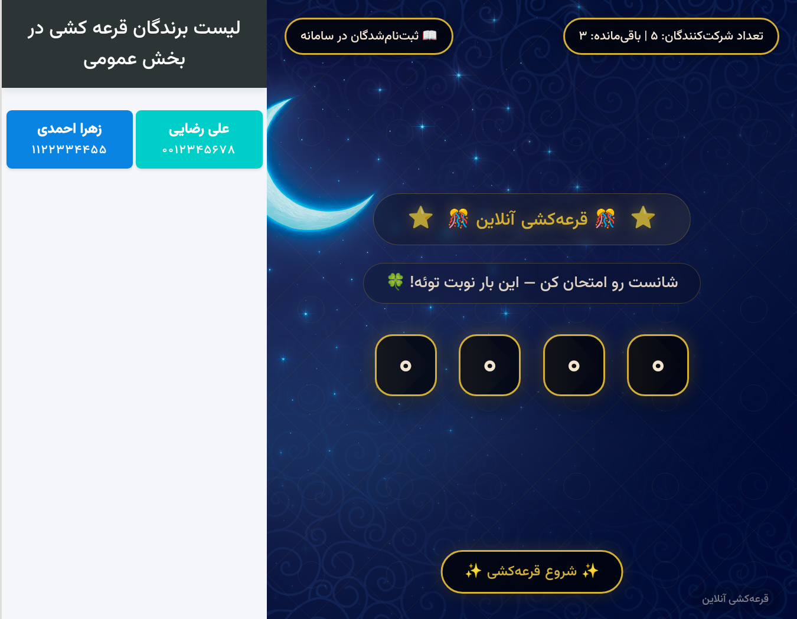

# سامانه قرعه کشی | Persian Lottery Draw 🎰

> سامانه‌ی قرعه‌کشی آنلاین و راست‌به‌چپ (RTL) با پنل مدیریت کامل — افزودن و وارد کردن شرکت‌کنندگان، قرعه‌کشی انیمیشنی، ذخیره‌ی برندگان و خروجی PDF/CSV. بدون دیتابیس، فقط PHP و JavaScript خالص.
>
> **Persian (Farsi) RTL lottery draw system** with a full admin panel — add/import participants, animated lottery draw, save winners, no database, just plain PHP.







## سامانه قرعه کشی چیست؟

«سامانه قرعه کشی» یک ابزار سبک و بدون وابستگی برای **برگزاری قرعه‌کشی آنلاین** است که برای جشنواره‌ها، مسابقات، نظرسنجی‌ها، کمپین‌های بازاریابی و مراسم‌ها ساخته شده. کافیست فایل‌ها را روی هاست خود کپی کنید، شرکت‌کننده‌ها را اضافه کنید و دکمه‌ی قرعه‌کشی را بزنید — همه‌چیز با انیمیشن و افکت جشن (Confetti) به نمایش درمی‌آید.

برخلاف ابزارهای قرعه‌کشی خارجی، این سامانه **کاملاً فارسی و راست‌به‌چپ** است: اعداد فارسی، فونت وزیرمتن، تاریخ شمسی و فرمت‌های داخلی ایرانی. همه‌ی داده‌ها در فایل‌های JSON ساده ذخیره می‌شوند؛ بدون نیاز به دیتابیس یا نصب.

## ✨ امکانات | Features

- 🎯 **قرعه‌کشی انیمیشنی** — چرخش اعداد با افکت جشن (Confetti) و نمایش نام برنده
- 📝 **افزودن/ویرایش/حذف شرکت‌کنندگان** — نام، کد ملی، موبایل و ایمیل
- 📥 **ورود انبوه** — درج مستقیم متن یا آپلود فایل CSV/اکسل با شناسایی خودکار فرمت
- 🏆 **ذخیره‌ی خودکار برندگان** و جلوگیری از انتخاب مجدد
- 🗂 **مدیریت برندگان** — مشاهده، حذف و پاک‌کردن
- 🖼 **پس‌زمینه‌ی قابل‌تغییر** — آپلود تصویر پس‌زمینه از پنل مدیریت
- 📊 **آمار** — تعداد شرکت‌کنندگان، برندگان و باقی‌مانده
- 🌐 **کاملاً فارسی و RTL** — فونت وزیرمتن، اعداد فارسی
- 🔒 **پنل مدیریت محافظت‌شده با رمز عبور**
- 📱 **طراحی واکنش‌گرا** — سازگار با موبایل و دسکتاپ
- 💾 **بدون دیتابیس** — ذخیره در فایل‌های JSON

## 🧱 معماری | Architecture

| فایل | نقش |
|---|---|
| `index.php` | صفحه‌ی اصلی قرعه‌کشی + API ذخیره/لیست برندگان |
| `admin.php` | پنل مدیریت (ورود، شرکت‌کنندگان، برندگان، آمار، تنظیمات) |
| `data.php` | صفحه‌ی نمایش لیست برندگان |
| `indexs.php` | صفحه‌ی نمایش عمومی (بایگانی) |
| `bg.png` | تصویر پس‌زمینه‌ی پیش‌فرض |
| `fonts/` | فونت وزیرمتن |

## 🚀 نصب و اجرا | Getting Started

نیازمندی: **PHP 7+** (بدون دیتابیس، بدون Composer)

```bash
# اجرای محلی
php -S localhost:8000
```

سپس مرورگر را روی `http://localhost:8000` باز کنید.

**پنل مدیریت:** `http://localhost:8000/admin.php` — نام کاربری و رمز پیش‌فرض: `admin` / `admin123`

> ⚠️ **حتماً بعد از نصب، رمز عبور پیش‌فرض را تغییر دهید** — یا از متغیرهای محیطی `LOTTERY_ADMIN_USER` / `LOTTERY_ADMIN_PASS` استفاده کنید، یا ثابت‌های `ADMIN_USERNAME` / `ADMIN_PASSWORD` را در ابتدای فایل `admin.php` ویرایش کنید.

برای محیط production کافیست فایل‌ها را روی هر هاست PHP (cPanel، Apache، Nginx) کپی کنید؛ پوشه‌ها باید قابل نوشتن باشند.

## 🔐 نکات امنیتی | Security Notes

- **رمز پیش‌فرض را حتماً تغییر دهید** — اطلاعات شرکت‌کنندگان (کد ملی، موبایل) حساس است.
- فایل‌های `participants.json` و `winners.txt` حاوی داده‌های حساس‌اند و در `.gitignore` قرار دارند — آن‌ها را در مکان عمومی منتشر نکنید.
- آپلود پس‌زمینه فقط فرمت‌های تصویری مجاز را می‌پذیرد.
- برای استفاده‌ی عمومی، توصیه می‌شود یک محافظت سطح وب (مثل `.htpasswd`) روی `admin.php` هم قرار دهید.

## ❓ سوالات متداول | FAQ

**سامانه قرعه‌کشی رایگان است؟** بله — کاملاً رایگان و متن‌باز تحت لایسنس MIT.

**به دیتابیس نیاز دارد؟** خیر. همه‌چیز در فایل‌های JSON ساده ذخیره می‌شود.

**چطور شرکت‌کننده‌ها را اضافه کنم؟** از پنل مدیریت: دستی، با درج متن (هر خط یک نفر با فرمت `نام - کد ملی`) یا آپلود فایل CSV با ستون‌های نام و کد ملی.

**آیا برنده‌ها دوباره انتخاب می‌شوند؟** خیر — برندگان ذخیره شده‌اند و از چرخه‌ی قرعه‌کشی حذف می‌شوند.

**روی هاست اشتراکی کار می‌کند؟** بله؛ هر هاستی که PHP داشته باشد کافیست.

## 🙏 Credits | ساخته شده توسط

- فونت: [Vazirmatn](https://github.com/rastikerdar/vazirmatn)

## 🌐 سازنده | Made by

ساخته‌شده توسط **[تایمیت — timit.ir](https://timit.ir/)** — مرجع آموزش وردپرس فارسی و خدمات طراحی سایت، سئو و دیجیتال مارکتینگ. 💙

Built by **[Timit — timit.ir](https://timit.ir/)** — Persian WordPress education, web design, SEO & digital marketing.

## 📄 لایسنس | License

MIT — see [LICENSE](LICENSE).

---

<sub>کلیدواژه‌ها: قرعه‌کشی، قرعه کشی آنلاین، سامانه قرعه‌کشی، قرعه‌کشی فارسی، قرعه‌کشی وردپرس، قرعه‌کشی اینستاگرام، قرعه‌کشی تلگرام، قرعه‌کشی جشنواره، قرعه‌کشی مسابقه، اسکریپت قرعه‌کشی php — Keywords: persian lottery, lottery draw system, farsi raffle, PHP lottery script, prize draw, random winner picker, giveaway tool, self-hosted raffle</sub>
